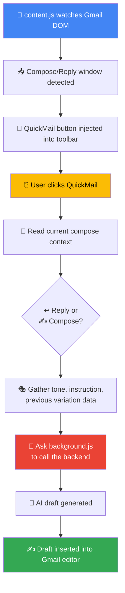
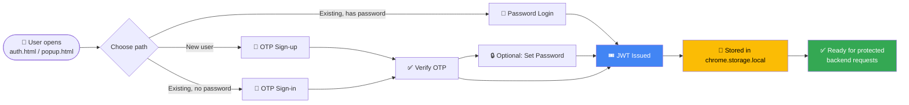
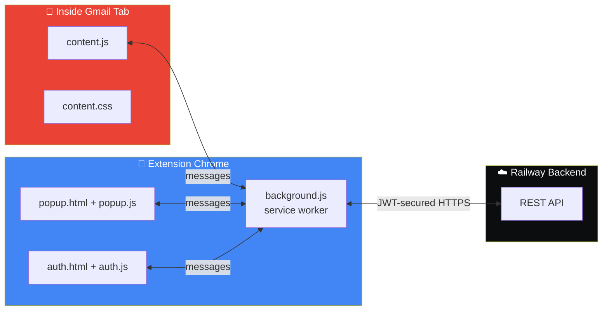

<div align="center">


<br/>


<br/>

[](https://github.com/bikashcode-dev/quickmail-AI-frontend/stargazers)
[](https://github.com/bikashcode-dev/quickmail-AI-frontend/commits)

</div>

**QuickMail** is a Chrome extension that adds AI-assisted email drafting directly inside Gmail's compose and reply boxes. It connects to the deployed [QuickMail backend](https://quick-email-ai-production.up.railway.app) on Railway for OTP authentication, JWT-secured access, and AI draft generation.

---

## 📌 Table of Contents

- [What It Does](#-what-it-does)
- [How It Works — Gmail Integration](#-how-it-works--gmail-integration)
- [Authentication Flow](#-authentication-flow)
- [Backend Communication](#-backend-communication)
- [Project Files](#-project-files)
- [Permissions](#-permissions)
- [Notes](#-notes)

---

## ✨ What It Does

<table>
<tr><td>🖱️</td><td><b>Inline Gmail Button</b></td><td>Adds a QuickMail action button inside Gmail compose <i>and</i> reply toolbars</td></tr>
<tr><td>↩️</td><td><b>Dual Mode</b></td><td>Works in both <b>reply mode</b> and <b>fresh compose mode</b></td></tr>
<tr><td>🎭</td><td><b>Tone Selection</b></td><td>User picks a tone before generation (formal, friendly, concise, etc.)</td></tr>
<tr><td>🔐</td><td><b>Local Auth Storage</b></td><td>Auth token stored securely in Chrome local storage</td></tr>
<tr><td>📩</td><td><b>OTP + Password Auth</b></td><td>Supports OTP verification <i>and</i> password login</td></tr>
<tr><td>🛡️</td><td><b>Protected API Calls</b></td><td>Sends JWT-secured draft-generation requests to the backend</td></tr>
</table>

---

## 🔄 How It Works — Gmail Integration

`content.js` watches Gmail for compose windows, locates the correct toolbar, and injects the QuickMail action button.



---

## 🔐 Authentication Flow

Auth state lives in `chrome.storage.local`. The extension supports four entry paths into the same secured session:



**Handled by:** `auth.js` (OTP signup/login flow) · `popup.js` (popup auth/session flow) · `background.js` (network + popup handling)

---

## 🌐 Backend Communication

**Base URL:**
```text
https://quick-email-ai-production.up.railway.app
```

| Method | Endpoint | Purpose |
|---|---|---|
| `POST` | `/auth/send-otp` | Send OTP to user's email |
| `POST` | `/auth/account-status` | Check if account exists / verification state |
| `POST` | `/auth/verify-otp` | Verify submitted OTP, issue JWT |
| `POST` | `/auth/login` | Password-based login |
| `POST` | `/auth/set-password` | Set password after OTP verification |
| `POST` | `/api/email/generate` | 🔐 Protected — generate AI email draft |

---

## 📁 Project Files

| File | Role |
|---|---|
| `manifest.json` | Extension metadata & permissions (Manifest V3) |
| `background.js` | Service worker — handles API requests & popup logic |
| `content.js` | Gmail DOM integration, tone UI, context extraction, draft insertion |
| `content.css` | Injected Gmail-side styling |
| `auth.html` | Auth window UI |
| `auth.js` | OTP signup/login flow |
| `popup.html` | Extension popup UI |
| `popup.js` | Popup auth/session flow |



---

## 🔑 Permissions

| Permission | Why |
|---|---|
| `storage` | Persist auth token & session state locally |
| Gmail host permission | Inject UI and read compose context inside Gmail |
| Deployed backend host permission | Allow JWT-secured requests to the Railway API |

---

## 📝 Notes

- 🧩 **Manifest version:** 3
- ⚙️ Background **service worker** handles all network requests
- 🖋️ **Content script** owns all Gmail UI integration
- 🔐 **JWT token** is attached to every protected backend request

---

<div align="center">


</div>
